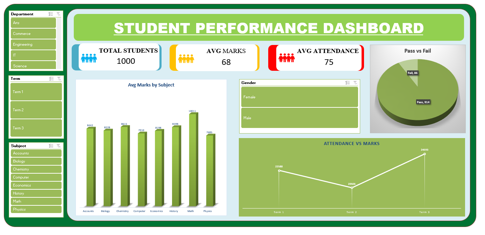

# 📊 Student Performance Dashboard (Excel)

An interactive and dynamic Excel dashboard designed to analyze and visualize the academic performance of 1,000 students. This project transforms raw student data into actionable insights for educators and administrators, allowing them to track performance metrics across different departments, terms, and subjects.

## 📌 Project Overview
Educational institutions generate massive amounts of data. This dashboard solves the problem of data overwhelm by providing a centralized, interactive view of student performance. It answers critical questions such as:
- What is the overall pass rate across the institution?
- Which subjects have the highest and lowest average marks?
- How does attendance correlate with academic performance?
- How do different departments and genders perform across various terms?

## 📸 Dashboard Preview

*(Note: Upload your main dashboard screenshot to a folder named `screenshots` in this repository to display it here).*

## 🚀 Key Features & Visuals

### 1. Top KPIs (Key Performance Indicators)
- **Total Students:** 1,000
- **Average Marks:** 68
- **Average Attendance:** 75%
- **Pass vs. Fail Rate:** 914 Pass (91%) vs. 86 Fail (9%)

### 2. Interactive Slicers
The dashboard includes dynamic slicers that instantly filter all visualizations:
- **Department:** Arts, Commerce, Engineering, IT, Science
- **Term:** Term 1, Term 2, Term 3
- **Subject:** Accounts, Biology, Chemistry, Computer, Economics, History, Math, Physics
- **Gender:** Male, Female

### 3. Visualizations Breakdown
- **Avg Marks by Subject (3D Column Chart):** Ranks subjects by total marks, identifying Math and Accounts as the highest-scoring subjects.
- **Attendance vs. Marks (Line Chart):** Tracks total marks/attendance trends across Term 1, Term 2, and Term 3, revealing a significant upward spike in Term 3.
- **Pass vs. Fail (3D Pie Chart):** Visually represents the overall success rate of the student body.

## 🛠️ Tech Stack & Excel Features Used
- **Microsoft Excel:** Data modeling, dashboard layout, and UI design.
- **Logical Formulas:** Utilized nested `IF` statements (e.g., `=IF([@Marks]>=40, "Pass", "Fail")`) to automate pass/fail categorization and grade banding (Excellent, Good, Average, Poor).
- **Pivot Tables & Pivot Charts:** Dynamically aggregated raw data to calculate sums and averages without writing complex queries.
- **Data Validation & Cleanup:** Ensured data types were correct and handled missing values to prevent calculation errors.

## 📂 How to Use This Repository
1. Download the `.xlsx` file from this repository.
2. Open it using Microsoft Excel (2016 or later recommended).
3. If prompted, **Enable Editing** to allow the dashboard to load fully.
4. Navigate to the "Dashboard" sheet.
5. Use the slicers on the left panel to dynamically filter data. Notice how the KPIs and charts update instantly.

## 📈 Key Insights Derived
- **High Success Rate:** The institution maintains a strong overall pass rate of 91%.
- **Subject Performance:** Math (10011 marks) and Accounts (8442 marks) are the strongest performing subjects, while Physics (7685 marks) and Computer (7910 marks) show lower aggregate scores.
- **Term Progression:** Student performance peaks significantly in Term 3 compared to Terms 1 and 2.
- **Departmental Trends:** (When filtered, the dashboard allows pinpointing which specific department or gender needs academic intervention).

## 🤝 Connect with Me
**Yash Nathu Khartode**
